# FPV Strike

An FPV strike-drone sandbox for Roblox. A quadcopter with a real flight model, three flight
modes, and three weapons — unguided rockets, a lock-on missile flying proportional navigation,
and a top-attack missile — with every hit decided by the server. The range fights back: SAM
sites hunt you, enemy drones dodge and flare, and the house comes apart brick by brick.

> **Built with AI.** This project was written with Claude (Anthropic's AI) as the coding agent,
> directed, play-tested and reviewed by me. It started as "rebuild this drone from a short clip,
> add missiles, and make it much better."


https://github.com/user-attachments/assets/a583cf6f-1c19-48cf-bceb-75f41b6c36f5


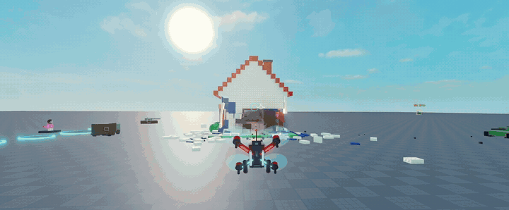

| | |
|---|---|
| 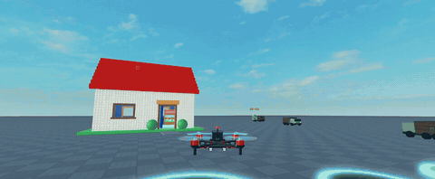<br><sub>A low pass in the chase cam</sub> | 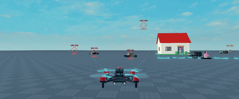<br><sub>Four locks, one trigger pull</sub> |
| 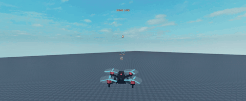<br><sub>A SAM launches; flares pull it off</sub> | 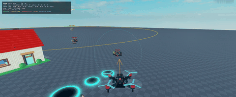<br><sub>F2 draws the guidance maths</sub> |
| 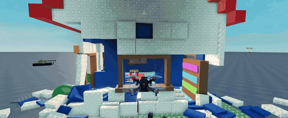<br><sub>Through the breach and out the window</sub> | 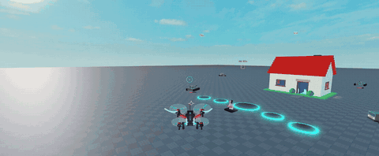<br><sub>Kamikaze: the feed cuts to static</sub> |

| | |
|---|---|
| 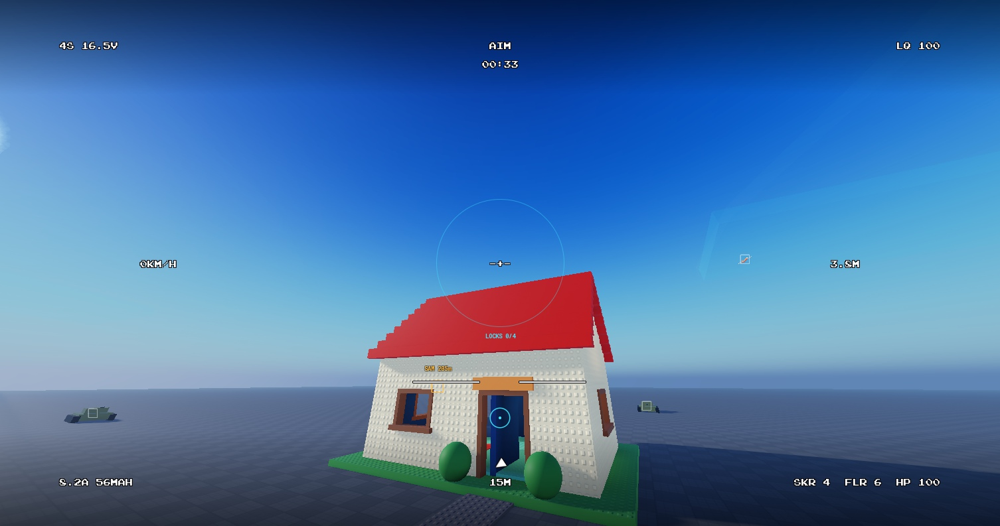<br><sub>Goggles OSD in FPV</sub> | 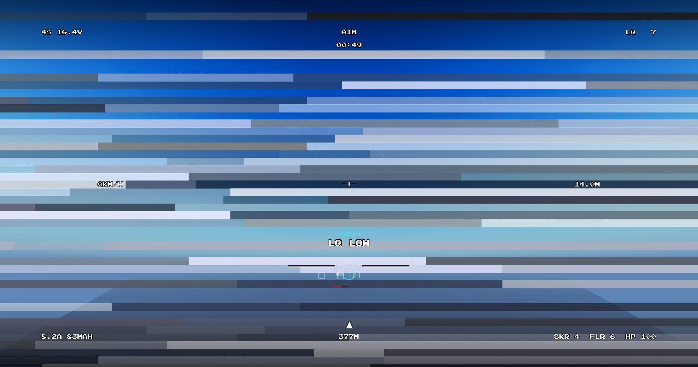<br><sub>Video breaking up at the edge of range</sub> |
| 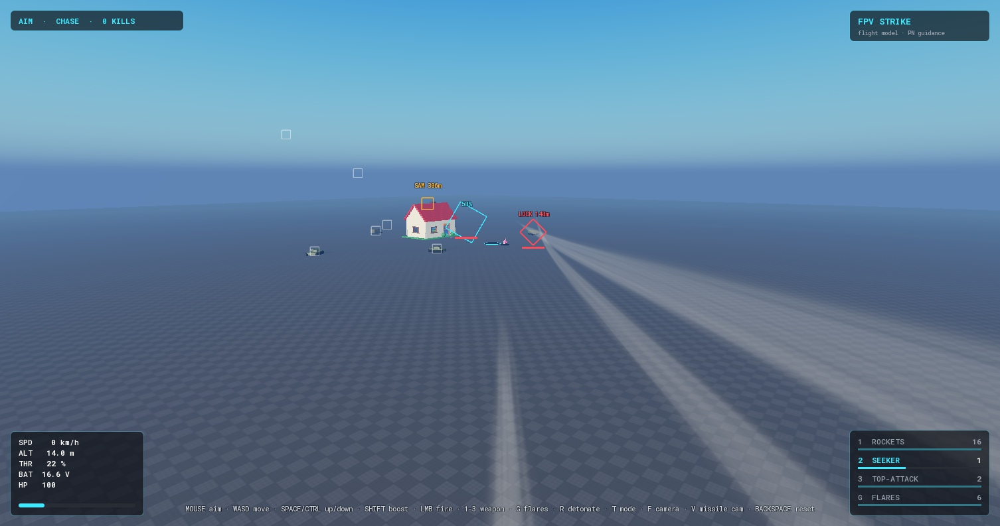<br><sub>Missile cam</sub> | 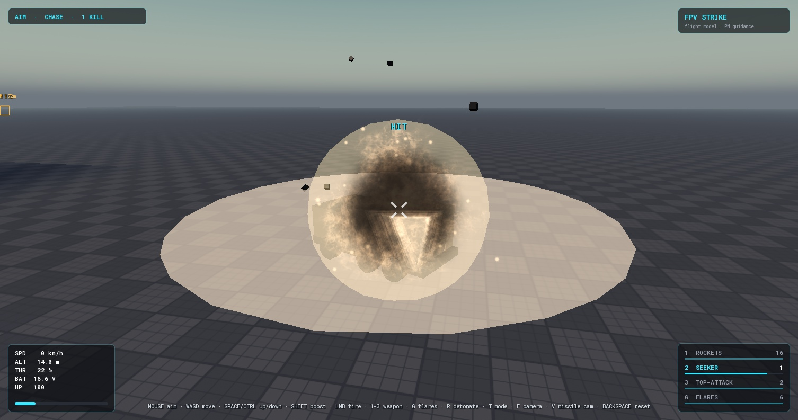<br><sub>Slow-motion kill cam</sub> |
| 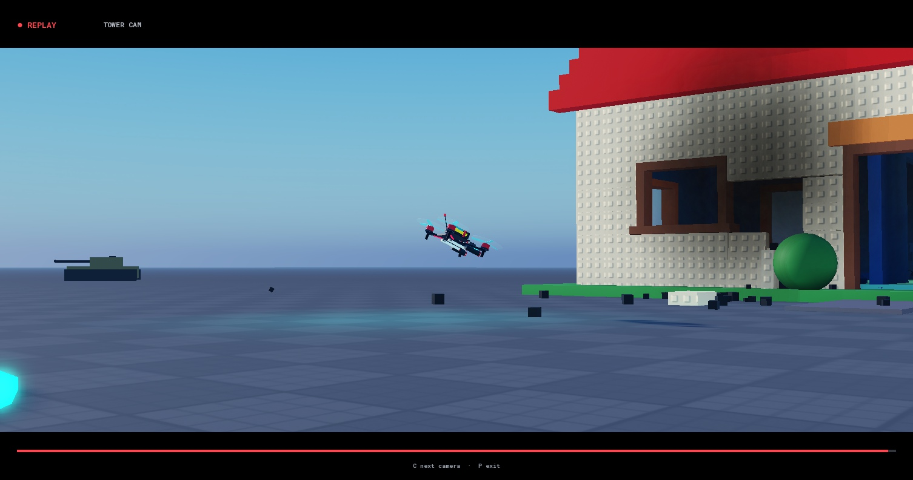<br><sub>Replay director: long-lens tower cam</sub> | 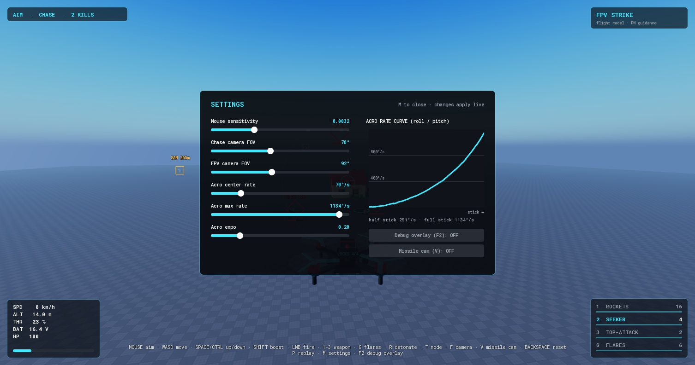<br><sub>Settings with the live rate curve</sub> |

## What's interesting in here

**A flight model, not a hover script.** Thrust only acts along the drone's up axis, so to move
it has to tilt — exactly like a real quad. Quadratic drag, ground effect, prop-wash wobble when
you sink through your own downwash, battery sag that weakens thrust, and a crash state that
cuts the motors and lets the frame tumble.

**Mouse-aim autopilot.** In Aim mode the mouse picks a direction and a velocity controller
works out the thrust vector needed to get there (with tilt limits and lift priority), then an
SO(3) attitude controller turns the drone to match. Banking into turns isn't animated — it
falls out of the physics.

**Three flight modes.** Aim (mouse autopilot), Angle (self-levelling, altitude hold) and Acro
(full rate mode using Betaflight's "Actual" rate curves, gamepad-ready).

**Real missile guidance.** The seeker flies true proportional navigation: it accelerates across
the line of sight in proportion to how fast that line is turning, so it leads moving targets
instead of chasing their tail. It lofts slightly over ground targets so it doesn't catch the
dirt, and falls back to a max-G turn when a target is more than 45° off the nose (where PN is
too weak to turn it).

**Top-attack profile.** The anti-armour missile soft-launches, climbs to the point a 60° dive
onto the target begins, tips over one turn radius early, and hits the roof at 54–61° from
150 to 1000 studs out.

**Multi-target lock-on.** A seeker cone and line-of-sight raycasts build locks over time (with a
shrinking diamond and quickening tone), up to four at once, then one trigger pull ripples a
missile off the rails per lock.

**Server-authoritative weapons.** The client draws its shot instantly, but the server validates
every shot (types, NaNs, launch distance from the drone, ammo with a latency grace), re-flies the
missile with the same shared code, and alone decides hits and damage. Clients predict impacts so
the shooter never sees a missile sail through a target, and get corrected if they guessed wrong.

**Deterministic moving targets.** Target paths are pure functions of server time, evaluated
identically on the server and every client — smooth on screen, consistent for hit checks, and
nearly free on the network.

**Air defence that fights back.** SAM sites sweep for drones, hold a radar lock for a couple of
seconds (you hear it, and an arrow points at the site), then cold-launch a missile straight up
that flies the same PN code as yours. You can't out-turn it. Your options: drop flares, put the
house between you and the radar, fly under 12 studs where the radar loses you in ground
clutter, or out-range it with the top-attack.

**Flares, where timing matters.** Flare paths are the closed-form solution of linear drag, so
like the targets they are pure functions of time: the server and every client agree on where
every flare is without sending a single update. Each missile homing on you gets one roll per
salvo, at the first moment a burning flare sits in its seeker cone. Pop them as the SAM leaves
the rail and they work once it tips over toward you; pop them too late and the decoyed missile
still bursts close enough to hurt.

**Enemy drones that dodge.** When your seeker closes in, an enemy drone breaks hard and fans
out flares. The break is a smooth offset layered onto its path, started by a server-set
attribute, so every client flies the identical manoeuvre and hit checks still agree.

**Destructible house.** The walls are laid brick by brick (533 of them). Every blast knocks
loose the bricks it reaches; they tumble as real physics, and the wall rebuilds itself 20 seconds
later. Rockets chip holes, a seeker opens a doorway, and a kamikaze run takes out a wall section.

**Kamikaze.** R detonates the drone itself, the original clip's attack. The server sets off the
warhead where you saw the drone (checked against its own view), and the feed cuts to analog
static, just as a real FPV strike looks from the goggles.

**Goggles OSD.** In FPV the panels give way to a Betaflight-style on-screen display in a pixel
font: pack voltage, flight mode and timer, link quality, speed, altitude, amps and mAh used, a
home arrow pointing back to the pilot, weapon and flare counts, an artificial horizon worked
out from the camera's own orientation, and blinking warnings in the middle.

**A radio link with real range.** Link quality falls with distance from the pilot standing
behind the pad, and drops further when a wall sits between them, so flying through the house
costs signal. As it falls, the picture tears into analog noise while the OSD stays crisp on top,
as it does in real goggles. When the link is gone the quad fails safe: the motors cut and it
drops.

**Missile cam and kill cam.** V rides your newest seeker or top-attack all the way in. If it
scores a kill, the camera drifts round the wreck with the colour drained while the blast plays
in slow motion. Roblox can't slow the world itself, so the slow motion comes from the particles'
own clock and the boom dropping in pitch.

**Replays with an automatic director.** P plays back the last 20 seconds. The recorder samples
your drone, every missile, burning flare and target 30 times a second and logs each explosion;
playback rebuilds them as local stand-ins while the real world carries on. A director cuts
between a chase cam, a long-lens tower cam planted on the ground (it zooms to keep the drone the
same size in frame), a slow orbit, and a missile cam whenever something guided launches. Like a
sports replay it skips to the action, starting a few seconds before the first launch, and if
you press P with missiles still flying it waits for them to land.

**A debug overlay that shows the maths.** F2 draws what the code is thinking, out in the world:
each missile's velocity, its line of sight to the point it's steering at, and the lateral
acceleration the guidance is commanding; the drone's thrust and the velocity the autopilot is
chasing; target velocities, SAM radar ranges and lock lines. A readout covers the controller's
commanded versus actual body rates, motor outputs, and the link.

**Settings with a live rate curve.** M opens sliders for mouse sensitivity, camera FOVs and the
Acro rates, plus a graph of the Betaflight "Actual" curve that redraws as you drag. Sliders write
into the shared config the controller reads every frame, so changes apply instantly.

**A guidance bug the tests caught.** The first SAM test failed: a missile launched straight up
never reached a drone just 400 studs away. Tracing the flight showed it settling at the exact
angle where the guidance hands over from a max-G turn to PN. Flying almost sideways to the
target there, its closing speed was tiny, so PN barely turned it; it slid back under the
threshold, pulled max G, crossed again, and orbited until it hit the ground. Moving the
handover from 78° to 45° off the nose fixed it. A parameter sweep confirmed the seeker and
top-attack still pass every test.

**Feel.** Spinning props that blur into discs, per-motor speed from a motor mix, motor pitch that
follows RPM, speed-scaled trails and FOV, spring-damped cameras with wall avoidance, explosions
whose sound arrives at the speed of sound, trauma-based camera shake, and hit markers.

## Controls

New players get a controls card on joining; it clears when they launch, and H brings it back.

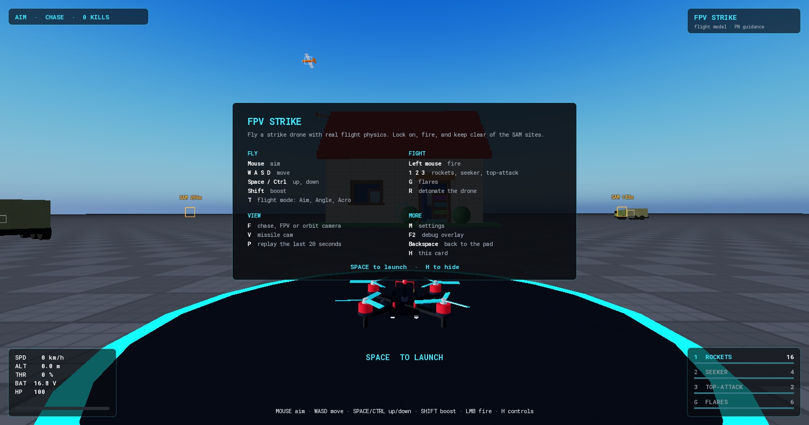

| | Keyboard + mouse | Gamepad |
|---|---|---|
| Aim / steer | Mouse | Right stick |
| Move | W A S D | Left stick |
| Up / down | Space / Ctrl | RT / LT |
| Boost | Shift | L1 |
| Fire | Left mouse | R1 |
| Weapon | 1 rockets · 2 seeker · 3 top-attack | D-pad up |
| Flares | G | B |
| Detonate (kamikaze) | R | L3 |
| Flight mode | T | X |
| Camera (chase / FPV / orbit) | F | Y |
| Missile cam | V | D-pad right |
| Replay (C next camera) | P | Select |
| Settings | M | |
| Debug overlay | F2 | |
| Reset to pad | Backspace | D-pad down |
| Controls card | H | |

Hold fire for rockets. For the seeker and top-attack, keep a target near the reticle until its
diamond turns red, then fire. The SAM sites (amber markers) sit past the range; "RADAR LOCK"
means one is about to fire, "MISSILE" means it has.

Up to five players each get a launch pad of their own.

## Project layout

```
src/shared/   Config, FlightModel (pure flight math), Missile (pure guidance), Flares (closed-form
              flare paths), Weapons (specs + ammo rule), TargetPaths (paths + evasive breaks),
              DroneBuilder (the drone, built from code), Smooth
src/server/   World (baseplate + brick-by-brick house), Targets, Combat (shot validation, missiles,
              flares and decoys, damage, breaking walls), Defenses (SAM radar and launches)
src/client/   DroneController, CameraRig (incl. missile and kill cams), DroneVisuals,
              WeaponController (incl. radar warning), MissileFx (missiles, flares, explosions),
              VideoLink (range, walls, failsafe), Hud, Osd (goggles display), Replay (recorder,
              player, director), DebugOverlay, Settings, Main
tests/        Lune tests that fly the real flight and guidance code
```

Everything — the drone, the house, the targets — is generated from code, so the whole project
diffs cleanly in Git. All tuning lives in `Config.luau` and `Weapons.luau`.

## Running it

Needs Roblox Studio. The toolchain (Rojo, Lune, Selene, StyLua, luau-lsp) is pinned in
`rokit.toml`; install it with [Rokit](https://github.com/rojo-rbx/rokit):

```bash
rokit install
```

```bash
rojo serve
```

Then in Studio: **Plugins → Rojo → Connect**, and press Play. Or build a place file directly:

```bash
rojo build -o fpv-strike.rbxl
```

Tests run outside Roblox with [Lune](https://lune-org.github.io/docs):

```bash
lune run tests/flight_model
lune run tests/missile
```

They fly the drone to cruise speed and check altitude hold and tilt limits, check the
Betaflight rate curve, send seekers at crossing, off-boresight and ground targets, fly top-attack
shots at four ranges and check the dive angle, run a SAM down a circling drone, check that a
flare pulls a SAM off and it bursts out of blast range, check the flare path against its own
velocity, and exercise the ammo/reload rule.

The code is linted with Selene, formatted with StyLua, and type-checked with luau-lsp against
Roblox's API definitions (several modules run in `--!strict`). All of it comes back clean:

```bash
selene src
```

```bash
stylua --check src tests
```

## Credits

- Motor sound: "drone_hover_loop" by GladGhost6 (Roblox Creator Store)
- Launch sound: "Missile Launch" by frstee (Roblox Creator Store, marked free to use)
- Lock tone: Pro Sound Effects "Nasa Transmission Beep 1" (via Roblox)
- Explosion sound and particle textures: Roblox built-in content

## Roadmap

- **Saved settings:** keep each player's sliders in a DataStore
- **Mobile controls:** on-screen sticks and buttons, so it plays on a phone
- **A game loop:** timed strike missions with a score, so a session has a start, a goal and an
  end
- **More threats:** an anti-aircraft gun firing tracers, for a threat flares can't stop
