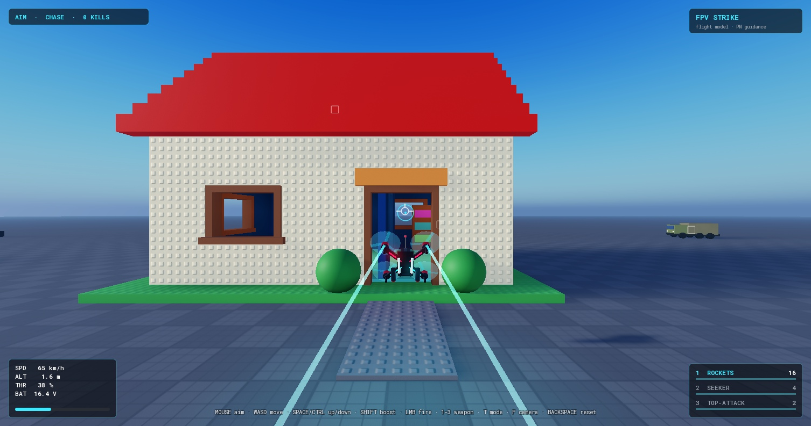
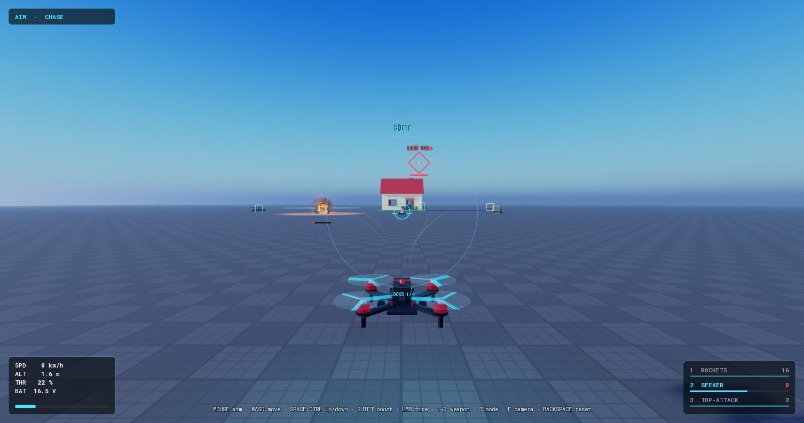
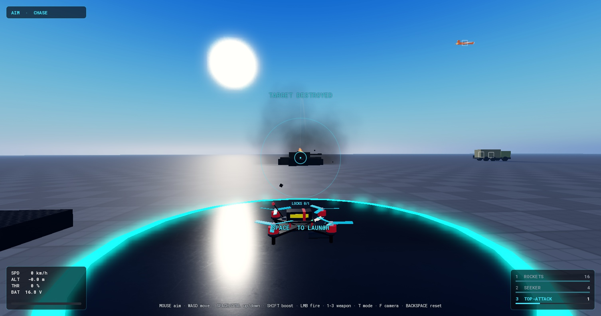
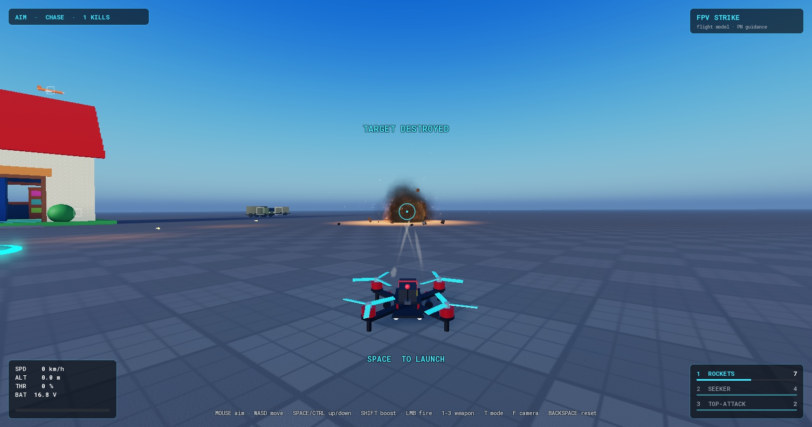
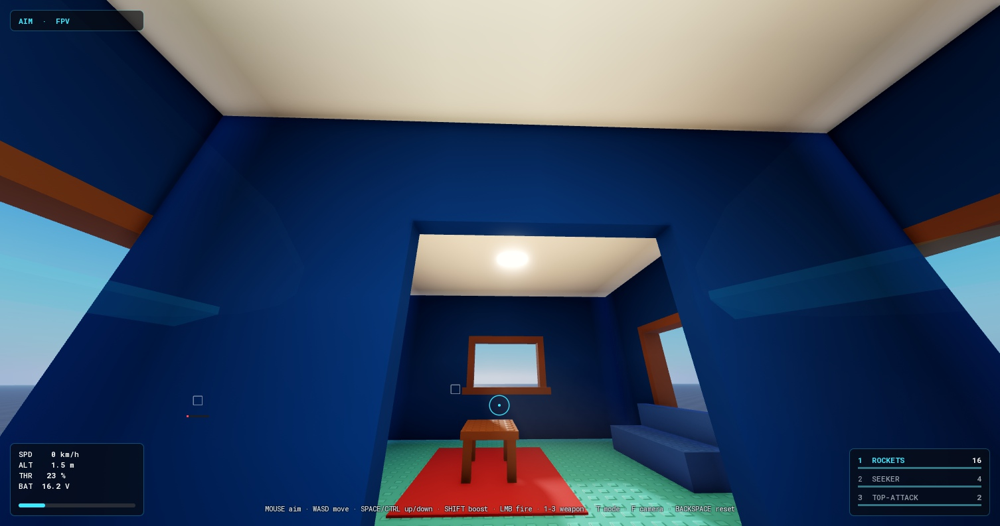

# FPV Strike

An FPV strike-drone sandbox for Roblox. A quadcopter with a real flight model, three flight
modes, and three weapons — unguided rockets, a lock-on missile flying proportional navigation,
and a top-attack missile — with every hit decided by the server.

> **Built with AI.** This project was written with Claude (Anthropic's AI) as the coding agent,
> directed, play-tested and reviewed by me. It started as "rebuild this drone from a short clip,
> add missiles, and make it much better."



| | |
|---|---|
|  |  |
|  |  |

## What's interesting in here

**A flight model, not a hover script.** Thrust only acts along the drone's up axis, so to move
it has to tilt — exactly like a real quad. Quadratic drag, ground effect, prop-wash wobble when
you sink through your own downwash, battery sag that weakens thrust, and a crash state that
cuts the motors and lets the frame tumble.

**Mouse-aim autopilot.** In Aim mode the mouse picks a direction and a velocity controller
works out the thrust vector needed to get there (with tilt limits and lift priority), then an
SO(3) attitude controller turns the drone to match. Banking into turns isn't animated — it
falls out of the physics.

**Three flight modes.** Aim (mouse autopilot), Angle (self-levelling, altitude hold) and Acro
(full rate mode using Betaflight's "Actual" rate curves, gamepad-ready).

**Real missile guidance.** The seeker flies true proportional navigation: it accelerates across
the line of sight in proportion to how fast that line is turning, so it leads moving targets
instead of chasing their tail. It lofts slightly over ground targets so it doesn't catch the
dirt, and falls back to a max-G turn when a target ends up behind it (where PN can't help).

**Top-attack profile.** The anti-armour missile soft-launches, climbs to the point a 60° dive
onto the target begins, tips over one turn radius early, and hits the roof at 55–75° from
150 to 1000 studs out.

**Multi-target lock-on.** A seeker cone and line-of-sight raycasts build locks over time (with a
shrinking diamond and quickening tone), up to four at once, then one trigger pull ripples a
missile off the rails per lock.

**Server-authoritative weapons.** The client draws its shot instantly, but the server validates
every shot (types, NaNs, launch distance from the drone, ammo with a latency grace), re-flies the
missile with the same shared code, and alone decides hits and damage. Clients predict impacts so
the shooter never sees a missile sail through a target, and get corrected if they guessed wrong.

**Deterministic moving targets.** Target paths are pure functions of server time, evaluated
identically on the server and every client — smooth on screen, consistent for hit checks, and
nearly free on the network.

**Feel.** Spinning props that blur into discs, per-motor speed from a motor mix, motor pitch that
follows RPM, speed-scaled trails and FOV, spring-damped cameras with wall avoidance, explosions
whose sound arrives at the speed of sound, and trauma-based camera shake.

## Controls

| | Keyboard + mouse | Gamepad |
|---|---|---|
| Aim / steer | Mouse | Right stick |
| Move | W A S D | Left stick |
| Up / down | Space / Ctrl | RT / LT |
| Boost | Shift | L1 |
| Fire | Left mouse | R1 |
| Weapon | 1 rockets · 2 seeker · 3 top-attack | D-pad up |
| Flight mode | T | X |
| Camera (chase / FPV / orbit) | F | Y |
| Reset to pad | Backspace | D-pad down |

Hold fire for rockets. For the seeker and top-attack, keep a target near the reticle until its
diamond turns red, then fire.

## Project layout

```
src/shared/   Config, FlightModel (pure flight math), Missile (pure guidance), Weapons (specs +
              ammo rule), TargetPaths, DroneBuilder (the drone, built from code), Smooth
src/server/   World (baseplate + house), Targets, Combat (shot validation, missiles, damage)
src/client/   DroneController, CameraRig, DroneVisuals, WeaponController, MissileFx, Hud, Main
tests/        Lune tests that fly the real flight and guidance code
```

Everything — the drone, the house, the targets — is generated from code, so the whole project
diffs cleanly in Git. All tuning lives in `Config.luau` and `Weapons.luau`.

## Running it

Needs [Rojo 7](https://rojo.space) and Roblox Studio.

```bash
rojo serve
```

Then in Studio: **Plugins → Rojo → Connect**, and press Play. Or build a place file directly:

```bash
rojo build -o fpv-strike.rbxl
```

Tests run outside Roblox with [Lune](https://lune-org.github.io/docs):

```bash
lune run tests/flight_model
lune run tests/missile
```

They fly the drone to cruise speed and check altitude hold and tilt limits, check the
Betaflight rate curve, send seekers at crossing, off-boresight and ground targets, fly top-attack
shots at four ranges and check the dive angle, and exercise the ammo/reload rule.

## Credits

- Motor sound: "drone_hover_loop" by GladGhost6 (Roblox Creator Store)
- Launch sound: "Missile Launch" by frstee (Roblox Creator Store, marked free to use)
- Lock tone: Pro Sound Effects "Nasa Transmission Beep 1" (via Roblox)
- Explosion sound and particle textures: Roblox built-in content

## Roadmap

- **Juice pass** — goggles-style OSD, analog FPV video breakup and "signal lost" on detonation,
  missile cam, slow-motion hit confirm
- **Smarter targets** — evasive enemy drones, flares that decoy the seeker, turrets that shoot
  back, destructible walls
- **Kamikaze mode** — the original clip's detonate-on-impact run, with a terminal dive assist
- **Showcase tools** — replay recorder with cinematic cameras, debug overlay that draws the
  guidance vectors, settings menu with a live rate-curve graph
